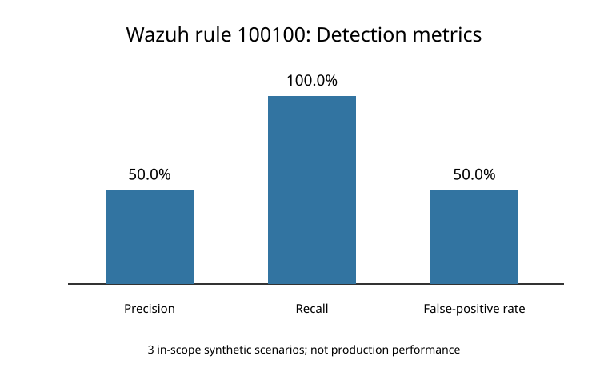
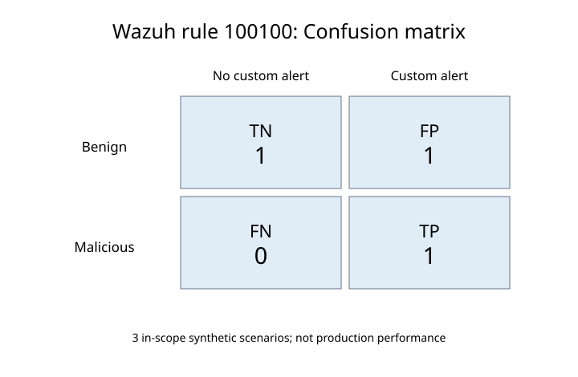

# Wazuh SSH Telemetry & False-Positive Analysis

## Project Overview

This advanced SOC project evaluates SSH authentication
telemetry, false positives, and detection accuracy using
Wazuh SIEM and Python.

## Lab Environment

- Operating System: Ubuntu 26.04 LTS
- Virtualization: Oracle VirtualBox
- SIEM: Wazuh 4.14.9
- Programming Language: Python 3
- Testing Tool: Wazuh Logtest
- Custom Detection Rule: 100100
- MITRE ATT&CK: T1110 - Brute Force

## Project Objectives

- Analyze SSH authentication logs.
- Evaluate custom detection rule 100100.
- Identify false-positive scenarios.
- Investigate detection coverage limitations.
- Calculate detection accuracy.
- Generate detection visualizations.
- Document findings and recommendations.

## SSH Telemetry Results

| Event Type | Log Entries |
|---|---:|
| Invalid usernames | 20 |
| Failed passwords | 23 |
| Successful logins | 1 |

Counts represent matching log entries, not unique attempts.

## Historical Wazuh Detections

| Rule ID | Alerts |
|---|---:|
| 100100 | 8 |
| 5710 | 42 |

## Controlled Detection Experiments

| Test | Scenario | Classification |
|---|---|---|
| T01 | Malicious invalid usernames | True Positive |
| T02 | Valid-user password guessing | Coverage limitation |
| T03 | Benign repeated username mistakes | False Positive |
| T04 | Single benign username mistake | True Negative |

T02 was detected by built-in Wazuh rule 5760 but
was outside the defined scope of custom rule 100100.

## Detection Accuracy

| Metric | Result |
|---|---:|
| True Positives | 1 |
| False Positives | 1 |
| False Negatives | 0 |
| True Negatives | 1 |
| Precision | 50.00% |
| Recall | 100.00% |
| False-Positive Rate | 50.00% |

These metrics are based on three selected synthetic
in-scope experiments, not production SOC traffic.

## Detection Visualizations

### Detection Metrics

### Confusion Matrix

## Reproduce the Analysis

Run these Python scripts from the repository root:

1. phase3-false-positive-analysis/scripts/analyze_results.py
2. phase3-false-positive-analysis/scripts/create_charts_svg.py

Both scripts use the Python standard library.

## Technical Report

[Read SOC Detection Quality Report](reports/SOC_DETECTION_QUALITY_REPORT.md)

## Key Findings

1. Rule 100100 detected repeated invalid SSH usernames.
2. Benign repeated username mistakes caused an alert.
3. Built-in Wazuh rule 5760 detected password failures.
4. Custom rule 100100 has limited SSH attack coverage.
5. Additional testing is needed before production use.

## Recommendations

- Evaluate detection thresholds.
- Add coverage for valid-user password guessing.
- Test distributed and slow SSH attacks.
- Reduce false positives using contextual information.
- Expand the labeled testing dataset.

## Limitations

- Small synthetic dataset.
- Manually assigned ground-truth labels.
- No production false-positive measurements.
- Limited SSH attack coverage.

## Conclusion

This project demonstrates SSH telemetry analysis,
custom Wazuh rule validation, false-positive testing,
and detection-quality assessment.
